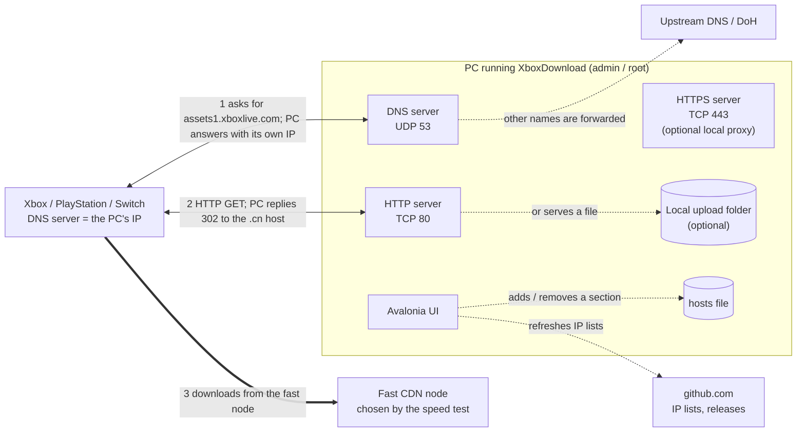
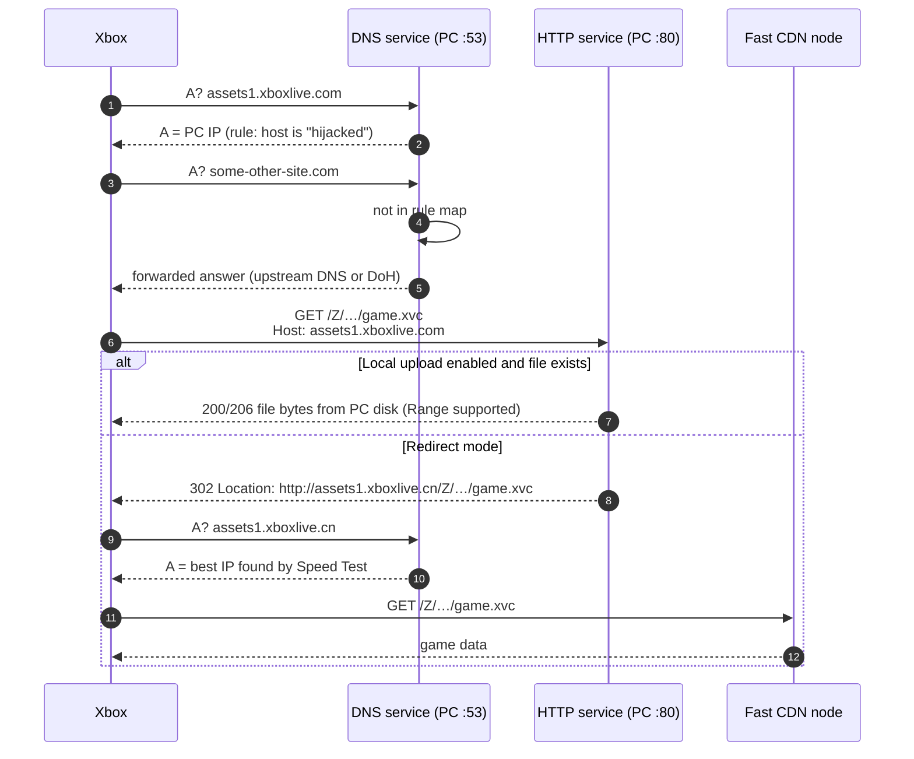
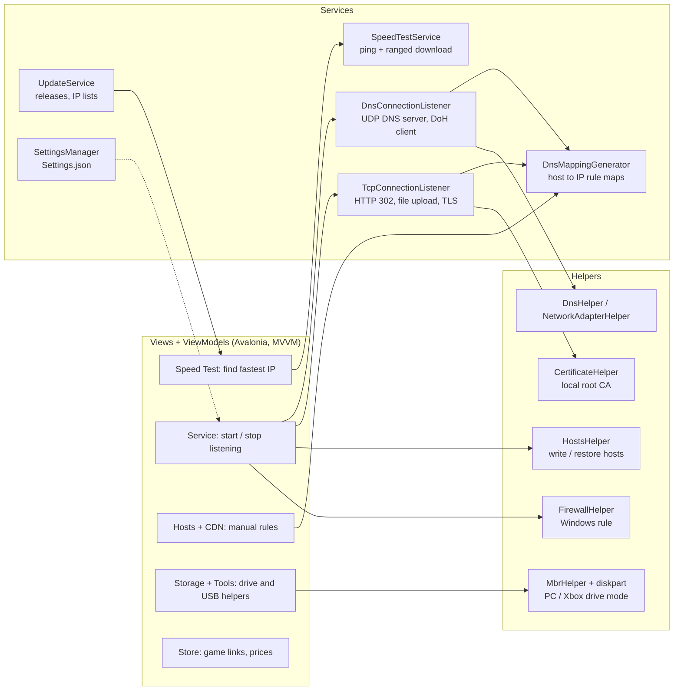
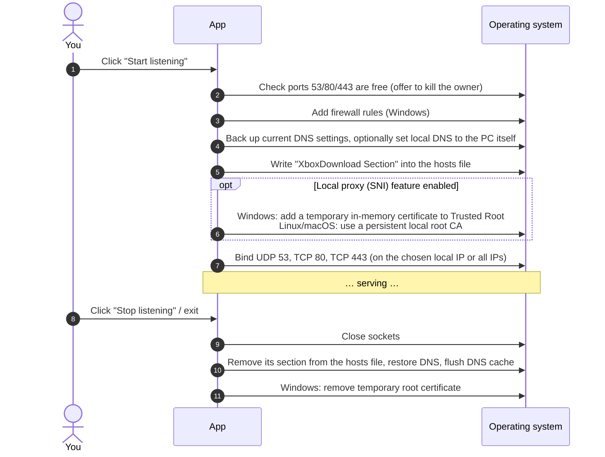
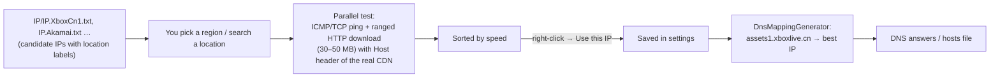
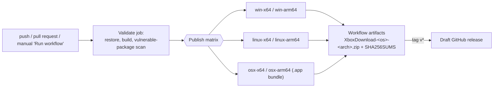

# How XboxDownload works

XboxDownload is a cross-platform desktop app (C# / .NET 10 / Avalonia UI, MVVM) that turns your PC into a small
**DNS server + HTTP/HTTPS server** for your home network. Devices that use the PC as their DNS server (an Xbox, PlayStation,
Switch, or the PC itself) are steered to faster download servers, and the PC can also serve game files to the console directly.

It does **not** patch any game or console; it only answers DNS questions, answers HTTP requests with redirects/files, and edits the `hosts` file.

---

## 1. The big picture

**Key idea:** the console asks "where is `assets1.xboxlive.com`?" and the PC answers with *its own* address.
When the console then connects, the PC replies with an HTTP `302` redirect to a faster host name/IP (for example the `.cn` CDN domain, which has
servers inside China), or serves the file straight from a folder on the PC (*local upload*).

---

## 2. Life of a download request

---

## 3. Components (what each folder does)

| Area | Files | What it does |
|---|---|---|
| Entry point | `Program.cs`, `App.axaml.cs`, `Setup.cs` | Single-instance mutex, Avalonia start-up, dependency injection (`HttpClient` factories) |
| DNS | `Services/DnsConnectionListener.cs`, `Models/Dns/*` | Parses DNS packets, answers rule-matched names with chosen IPs, forwards the rest (plain UDP or DNS-over-HTTPS) |
| HTTP/HTTPS | `Services/TcpConnectionListener.cs` | Plain HTTP redirect/file server; HTTPS with a locally generated certificate (only for the optional "local proxy / SNI" feature) |
| Speed test | `Services/SpeedTestService.cs`, `ViewModels/SpeedTestViewModel.cs` | Pings and downloads a few MB from many candidate IPs (`IP/*.txt`) and ranks them |
| Hosts | `Helpers/IO/HostsHelper.cs` | Adds a clearly delimited section to the OS hosts file while listening; removes it on stop |
| Store | `ViewModels/StoreViewModel.cs` | Looks up a game in the Microsoft Store API and shows its package download links / prices |
| Storage | `Helpers/IO/MbrHelper.cs`, `ViewModels/Storage*` | Flips an external drive's boot-sector signature between PC mode (`55 AA`) and Xbox mode (`99 CC`) so files can be pre-copied |
| Updates | `Services/UpdateService.cs` | Checks GitHub for a newer release, downloads it and swaps the files; also refreshes `IP/*.txt` |
| Data | `IP/*.txt`, `IP/Translation.json`, `Resources/*.txt` | Candidate CDN IP lists (auto-updated by the upstream repo), location-name translations, certificate-domain lists |

---

## 4. Start-up / shut-down sequence (what changes on your PC)

If the app crashes, these changes may stay behind. See [SECURITY.md](../SECURITY.md#cleanup-after-a-crash) for how to undo them.

---

## 5. Speed test & IP lists

The IP lists are plain text files in `IP/`. A GitHub bot in the upstream repository refreshes them regularly
(the *AutoUpdate IP.\*.txt* commits), and the app downloads the refreshed copies from GitHub on demand.

---

## 6. Release build pipeline (this fork)

See `.github/workflows/build.yml`.
